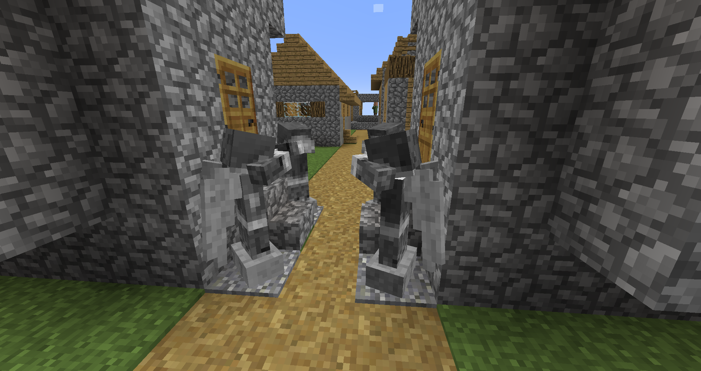

# Vintage Angels

## Created for Halloween 2026! 🎃

**Vintage Angels** is a 1.12.2 mod that adds mysterious stone angels that stalk you (using assets from the original **Weeping Angels** mod by a_dizzle).

These angels will freeze in place when seen, but will rush towards a target as soon as no one is looking at them. They can also teleport their target around and must be hit with a pickaxe to take full damage.

The mod is very configurable, you can make angels completely invincible, or much stronger than they should be if you want.

---

### Features

#### Entities
- **Weeping Angel**: Stalks when not seen and teleports its target when damaging. Requires a pickaxe to take full damage.

#### Blocks
- **Angel Statue:** Rare drop from Weeping Angels. Can be placed on the world and even rotated when right-clicking (or rotated the other way around while also sneaking).

### 🔁 Mod Integration
- **[Future Fireproof](https://www.curseforge.com/minecraft/mc-mods/future-fireproof)**
    - Certain items will become fireproof and won't be destroyed by fire or lava (highly recommended!).
- **[Just Enough Resources (JER)](https://www.curseforge.com/minecraft/mc-mods/just-enough-resources-jer)**
    - Support added for the Weeping Angel.
- **[Thaumcraft](https://www.curseforge.com/minecraft/mc-mods/thaumcraft)**
    - All content added by Vintage Angels will have aspects.

---

### 🙏 Special Thanks

- Creating the original **Weeping Angels** mod which this mod uses assets from ~ a_dizzle
- Helping with code cleanup and testing the mod ~ ACGaming

---

## Licensing

**Weeping Angels Assets:** [Apache License 2.0](https://github.com/TheTemportalist/WeepingAngels/blob/master/LICENSE)

All code and assets specifically made for this mod are licensed as All Rights Reserved. All other assets, including those derived from Minecraft or third-party sources, remain the property of their respective owners.

You may not upload a fork or utilize the assets without permission. You are however free to include this mod in any modpacks of yours, make addons with the mod as a dependency, learn from the code, or modify it privately.

---